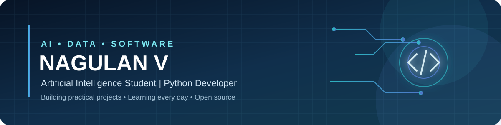

 

# Hi, I'm Nagulan V 👋

### 🤖 Artificial Intelligence Student · 🐍 Python Developer · 📊 Aspiring Data Scientist

---

## 👨‍💻 About Me

- 🎓 AI student at **St. Joseph's Institute of Technology**
- 🐍 Interested in **Python, data analysis, and machine learning**
- 🧠 Exploring practical applications of **Artificial Intelligence**
- 💻 Practising **DSA, algorithms, and problem solving**
- 🌱 Learning by building projects and contributing to open source
- 🎯 Goal: become a **Data Scientist**

> *Learn consistently. Build useful things. Share what you learn.*

## ⚙️ Tech Stack

## 🚀 Featured Projects

<table>
<tr>
<td width="50%" valign="top">

### 📊 Customer Churn Prediction

Machine learning workflow for customer churn analysis, including data cleaning, encoding, model training, and evaluation.

**Tools:** Python · Pandas · scikit-learn · Matplotlib · Seaborn

</td>
<td width="50%" valign="top">

### 🤖 AI Resume Analyzer

AI-powered resume analysis project designed to process resume content and return structured insights.

**Focus:** AI workflows · LLM integration · Structured output

</td>
</tr>
</table>

## 🌍 Open Source

Contributing through bug fixes, accessibility improvements, tests, and documentation/content updates.

- [Fix Lithuanian number-first section marker detection](https://github.com/speedyk-005/yasbd-lib/pull/330) — **Merged**
- [Fix accessible names for POS quantity inputs](https://github.com/phpledger/phpledger/pull/65) — **Merged**
- [Add adapter conformance suite](https://github.com/NU-BSE/frontend/pull/59) — **Merged**
- [Fix CheckerboardDataset noise rejection](https://github.com/soran-ghaderi/torchebm/pull/327) — **Merged**
- [Add Japanese false-friend content](https://github.com/lingdojo/kana-dojo/pull/30367) — **Merged**
- [Add Japanese cultural etiquette tip](https://github.com/lingdojo/kana-dojo/pull/30364) — **Merged**

## 📊 GitHub Analytics

 

 

## 🧩 Problem-Solving Progress

### LeetCode

| Difficulty | Solved |
|:--|--:|
| 🟢 Easy | 117 |
| 🟡 Medium | 11 |
| 🔴 Hard | 1 |

**Topics:** Arrays · Strings · Two Pointers

[Visit LeetCode](https://leetcode.com/)

### SkillRack

[Visit SkillRack](https://www.skillrack.com/)

## 🏆 Certifications & Learning

- 🏅 **Oracle Certified Foundations Associate — Agentic AI**
- 📘 **NPTEL — Python for Data Science**
- 🚀 **30-Day LeetCode Challenge**
- 🌱 Continuous learning in AI, data science, and software development

## 🤝 Connect With Me

---

### 🚀 Keep Learning · Keep Building · Keep Growing

